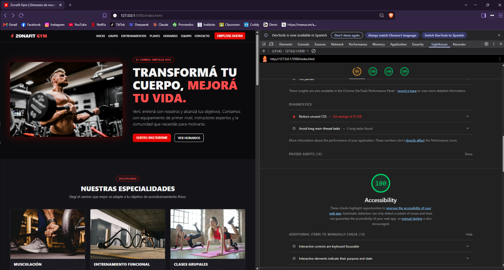
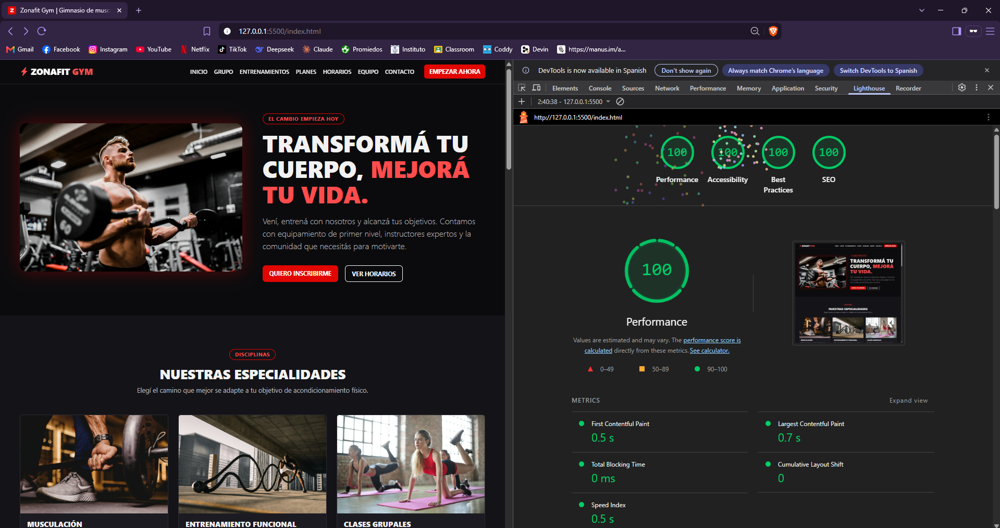

# Auditoría Lighthouse - Zonafit Gym

## Datos de la auditoría

- **Fecha:** 11/10/2026
- **Herramienta:** Lighthouse (DevTools del navegador Brave, basado en Chromium)
- **Modo:** Navigation, en ventana privada (sin extensiones)
- **URL analizada:** `http://127.0.0.1:5500/index.html` (Live Server)
- **Categorías:** Performance, Accessibility, Best Practices y SEO

## Resultados

| Categoría      | Mobile | Desktop |
| -------------- | :----: | :-----: |
| Performance    |   89   |   100   |
| Accessibility  |  100   |   100   |
| Best Practices |  100   |   100   |
| SEO            |  100   |   100   |

### Mobile

### Desktop

## Métricas de rendimiento

| Métrica                        | Mobile | Desktop |
| ------------------------------ | :----: | :-----: |
| First Contentful Paint (FCP)   | 1.9 s  |  0.5 s  |
| Largest Contentful Paint (LCP) | 3.6 s  |  0.7 s  |
| Total Blocking Time (TBT)      |  0 ms  |  0 ms   |
| Cumulative Layout Shift (CLS)  |   0    |    0    |
| Speed Index                    | 1.9 s  |  0.5 s  |

## Análisis

### Performance en Mobile (89)

Lighthouse en modo Mobile simula un celular de gama media con una conexión lenta, por eso los tiempos son mayores que en Desktop. La métrica más baja es el **LCP (3.6 s)**, que corresponde a la imagen principal del hero.

Diagnósticos informados:

- **Reduce unused CSS (22 KiB):** Bootstrap se carga completo desde el CDN y la página usa solo una parte de sus estilos.
- **Avoid long main-thread tasks (3):** tareas largas al cargar los scripts.

Posibles mejoras a futuro:

- Convertir las imágenes a formato **WebP** y reducir su tamaño.
- Cargar solo los componentes de Bootstrap que se usan.

### Accesibilidad (100)

Medidas aplicadas en el sitio:

- `lang="es"` en la etiqueta `<html>`.
- Estructura semántica: `header`, `nav`, `main`, `section`, `footer`, `address`, `blockquote`, `figure`.
- Enlace "Saltar al contenido" para usuarios de teclado.
- Orden correcto de títulos (`h1` → `h2` → `h3`); se usa `class="h5"` para achicar visualmente sin romper la jerarquía.
- Texto alternativo (`alt`) descriptivo en todas las imágenes.
- `aria-label` en los botones que solo tienen un ícono (menú y redes sociales) y `aria-hidden="true"` en los íconos decorativos.
- Formulario con `<label for>` vinculado a cada campo, mensajes de error visibles y `role="status"` para anunciar el envío.
- Tabla de horarios con `caption` y `scope` en los encabezados.
- Contraste suficiente: para textos rojos sobre fondo oscuro se usa un rojo más claro (`#ff4d4d`).
- Foco visible al navegar con teclado (`:focus-visible`).
- Botones de redes sociales de 44×44 px (tamaño mínimo táctil recomendado).

### Best Practices y SEO (100)

- Página servida sin errores en la consola.
- Bootstrap cargado desde CDN con `integrity` y `crossorigin`.
- Enlaces externos con `rel="noopener"`.
- `meta description`, `meta viewport`, título descriptivo y favicon.
- Imágenes con `width` y `height` declarados (evita saltos de contenido, CLS = 0).

## Problemas corregidos durante el desarrollo

- **Scroll horizontal en celulares:** las filas con `row g-5` de Bootstrap generaban un desborde lateral. Se reemplazó por `g-4 g-lg-5`.
- **Formato del código:** se aplicó **Prettier 3** (`npx prettier@3 --write`) a `index.html`, `css/styles.css` y `js/main.js`, y se verificó con `--check`.

## Conclusión

El sitio obtiene **100 en Accesibilidad, Buenas Prácticas y SEO** en ambos dispositivos, y **100 de Performance en Desktop**. El único punto a mejorar es el rendimiento en celulares, principalmente por el peso de la imagen principal.